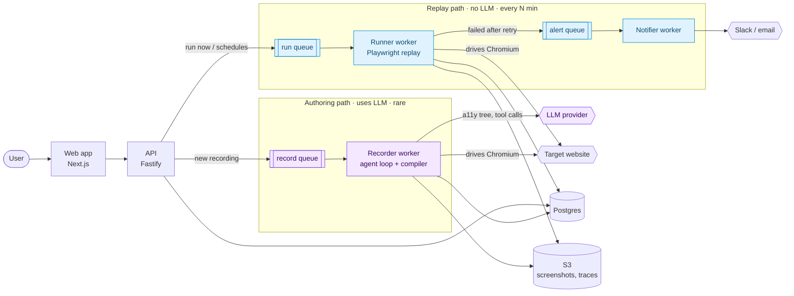

# GhostRider


**AI-authored synthetic monitoring for small teams.** Describe a critical user journey in plain English, like _"sign up with a new email and confirm the dashboard loads."_ An AI browser agent performs it once, and GhostRider compiles what it did into a deterministic Playwright script. That script replays on a schedule **with no AI in the loop**, and you get alerted, with a screenshot, the moment the journey breaks.

## How it works

AI is good at _figuring out_ how to do a task, and too slow, expensive and nondeterministic to run every few minutes. So GhostRider splits the work into two paths ([ADR-003](docs/adr/0003-ai-at-authoring-deterministic-replay.md)):

- **Authoring** (rare, uses AI): an agent records the journey once, and a compiler turns its trace into a Playwright script.
- **Replay** (every few minutes, **no AI**): a worker runs the compiled script, retries once on failure, then alerts.

The runner worker has no LLM credentials at all, so the replay path can't call a model even by accident.



<sub>Purple = authoring path (calls the LLM). Blue = replay path (never calls the LLM). Queues live in Redis and are managed by BullMQ.</sub>

See [architecture.md](docs/architecture.md) for the components, job flow and sequence diagrams.

## Status

| Milestone | What it delivers                                                         | Status  |
| --------- | ------------------------------------------------------------------------ | ------- |
| **M0**    | Design docs, ADRs, monorepo, Docker Compose stack, CI                    | ✅ Done |
| **M1**    | Agent spike: English goal → agent drives Playwright → step trace         | Next    |
| **M2**    | Compiler: trace → deterministic Playwright script                        |         |
| **M3**    | Platform core: auth, journeys, BullMQ queues and schedules, workers      |         |
| **M4**    | Slack and email alerts, run history, step replay viewer                  |         |
| **M5**    | Hardening and launch: domain verification, encrypted credentials, deploy |         |
| **M6–M7** | AI diagnosis and repair of failed runs; model evals                      |         |
| **M8**    | Launch to real users; public cost and reliability metrics                |         |

## Tech stack

- **Language:** TypeScript 7 everywhere ([ADR-002](docs/adr/0002-all-typescript-monorepo.md)), in a pnpm + Turborepo monorepo
- **Web:** Next.js 16 (App Router, React 19)
- **API:** Fastify 5, Drizzle ORM, Zod 4 contracts shared through `packages/shared`
- **Data:** Postgres 18 for all state; Redis 8 + BullMQ for queues and schedules ([ADR-004](docs/adr/0004-postgres-state-redis-bullmq-jobs.md))
- **Browser automation:** Playwright
- **Tooling:** Biome, Vitest, Docker (multi-stage builds), GitHub Actions

## Getting started

### Run everything in containers

Needs only [Docker](https://www.docker.com/) with Docker Compose.

```bash
git clone https://github.com/romance939913/GhostRider.git
cd GhostRider
docker compose up --build
```

Compose starts Postgres and Redis, runs database migrations as a one-shot `migrate` service, then starts the API and the web app. Open [localhost:3000](http://localhost:3000) to see the stack's health, or check the API directly:

```bash
curl -i localhost:4000/health
# HTTP/1.1 200 OK
# {"status":"ok","checks":{"postgres":"ok","redis":"ok"},...}
```

If Postgres or Redis is down, `/health` returns `503` and names the dependency that failed.

### Develop locally

Prerequisites: [Node.js](https://nodejs.org/) 26 (see `.nvmrc`), [pnpm](https://pnpm.io/) 12 (`npm install -g pnpm`) and Docker.

```bash
nvm use                                   # switches to Node 26
pnpm install
cp .env.example .env                      # local defaults work as-is

docker compose up -d postgres redis       # infrastructure only
pnpm --filter @ghostrider/db db:migrate
pnpm dev                                  # API on :4000, web on :3000, with hot reload
```

`pnpm dev` builds the shared packages first, then runs the API and web app together. Use `pnpm dev:api` or `pnpm dev:web` to run just one.

### Useful commands

| Command                     | What it does                                                |
| --------------------------- | ----------------------------------------------------------- |
| `pnpm dev`                  | Run the API and web app with hot reload                     |
| `pnpm dev:api` / `dev:web`  | Run one of them                                             |
| `pnpm build`                | Build every package (cached by Turborepo)                   |
| `pnpm test`                 | Run all tests (Vitest)                                      |
| `pnpm typecheck`            | Type-check every package                                    |
| `pnpm lint`                 | Lint and check formatting (Biome)                           |
| `pnpm format`               | Fix formatting automatically                                |
| `docker compose up --build` | Build and run the full stack in containers                  |
| `docker compose down`       | Stop the stack (add `-v` to delete Postgres and Redis data) |

Every push and pull request runs CI: lint, typecheck, tests and build, plus a smoke test that boots the full Compose stack and checks `/health` and the web page.

## Repository layout

```
apps/
  api/              Fastify API (/health so far)
  web/              Next.js app (health page so far)
packages/
  shared/           Zod schemas shared across apps
  db/               Drizzle schema, migrations and migration runner
docs/               Product spec, architecture, data model, ADRs
Dockerfile          Multi-stage build with api, web and migrate targets
.github/workflows/  CI
```

## Design docs

- [v1 product spec](docs/v1-product-spec.md): what v1 does, and deliberately doesn't do
- [Architecture](docs/architecture.md): system diagram, components, job flow, security boundaries
- [Data model](docs/data-model.md): tables, retention and screenshot storage
- [Architecture decision records](docs/adr/):
  - [ADR-001](docs/adr/0001-record-architecture-decisions.md): Record architecture decisions
  - [ADR-002](docs/adr/0002-all-typescript-monorepo.md): All-TypeScript monorepo
  - [ADR-003](docs/adr/0003-ai-at-authoring-deterministic-replay.md): AI at authoring time, deterministic replay at run time
  - [ADR-004](docs/adr/0004-postgres-state-redis-bullmq-jobs.md): Postgres for state; Redis + BullMQ for jobs and schedules
  - [ADR-005](docs/adr/0005-provisional-data-model-and-trace-format.md): Data model and trace format are provisional until M1

## How it compares

_Placeholder: the other rows get filled in after a proper comparison (M8)._

|                                | Authoring                              | AI at run time                    | Self-healing                   | Built for                      |
| ------------------------------ | -------------------------------------- | --------------------------------- | ------------------------------ | ------------------------------ |
| **GhostRider**                 | Plain English, recorded by an AI agent | None; compiled Playwright replays | Planned (M6), always disclosed | Small teams, production        |
| Ghost Inspector                | _TBD_                                  | _TBD_                             | _TBD_                          | _TBD_                          |
| Checkly                        | _TBD_                                  | _TBD_                             | _TBD_                          | _TBD_                          |
| Datadog Synthetic Monitoring   | _TBD_                                  | _TBD_                             | _TBD_                          | _TBD_                          |
| Hand-written Playwright + cron | Code                                   | None                              | None                           | Teams with time to maintain it |
