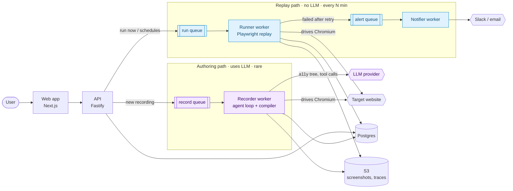
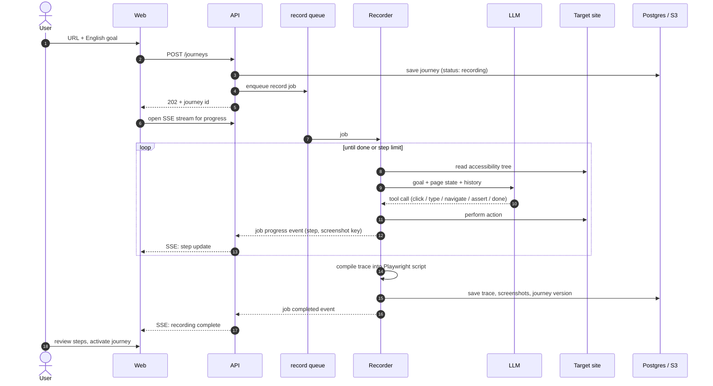
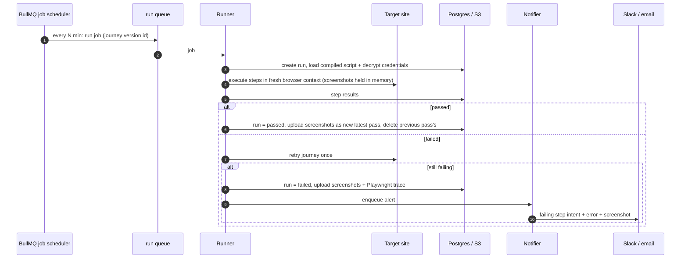

# GhostRider — Architecture

> **Status:** Draft v0.3 · Last updated: 2026-11-10
> Related: [Spec](./v1-product-spec.md) · [Data model](./data-model.md) · [ADRs](./adr/)

## 1. System overview

GhostRider is an all-TypeScript system ([ADR-002](./adr/0002-all-typescript-monorepo.md)) with two paths through it:

- **Authoring path** (rare, slow, uses AI): an agent records a journey and the compiler turns it into a Playwright script.
- **Replay path** (every few minutes, fast, **no AI**): a worker runs the compiled script and alerts on failure.

Postgres holds all state, and Redis + BullMQ handle jobs and schedules ([ADR-004](./adr/0004-postgres-state-redis-bullmq-jobs.md)).



<sub>Purple = authoring path (calls the LLM). Blue = replay path (never calls the LLM). Queues live in Redis and are managed by BullMQ.</sub>

## 2. Components

| Component | Tech | Responsibility |
|---|---|---|
| **Web app** (`apps/web`) | Next.js | Dashboard, journey authoring UI, run history and step replay viewer, landing page and live demo. Talks only to the API. |
| **API** (`apps/api`) | Fastify, Drizzle | Auth, journeys/runs CRUD, domain verification, enqueueing jobs, managing journey schedules, streaming recording progress to the browser (SSE). The only component the browser talks to. |
| **Queues & schedules** | Redis + BullMQ | `record`, `run` and `alert` queues. Retries with backoff, timeouts, concurrency limits, stalled-job recovery. Recurring journey schedules are BullMQ **job schedulers**, so there's no separate cron service. |
| **Recorder worker** (`apps/worker`, role `recorder`) | Playwright, `packages/agent`, `packages/compiler` | Runs the agent loop against the target site, writes the trace, compiles it into a journey version. **The only component with an LLM API key.** |
| **Runner worker** (`apps/worker`, role `runner`) | Playwright | Executes a compiled journey version in a fresh browser context, saves step results and artifacts, retries a failed journey once, enqueues an alert on a confirmed failure. **Has no LLM credentials.** |
| **Notifier worker** (`apps/worker`, role `notifier`) | Slack webhooks, email provider | Sends failure and recovery alerts and dedupes repeat alerts while a journey stays down. |
| **Postgres** | Postgres 16, Drizzle migrations | Source of truth: users, sites, journeys, journey versions, runs, step results, alert channels, encrypted credentials. |
| **Redis** | Redis 7 | BullMQ queues and schedules, recording-progress events, demo rate limiting. Holds no state that can't be rebuilt from Postgres. |
| **Object storage** | S3 (MinIO locally) | Screenshots, Playwright trace files, agent traces. Postgres stores only keys. |
| **Shared contracts** (`packages/shared`) | Zod | Trace format, job payloads and API types, shared by web, API and workers. One definition gives both static types and runtime validation. |

One `apps/worker` codebase starts as a recorder, runner or notifier based on `WORKER_ROLE`. Locally that's one container. In production each role can scale on its own; runners are the high-volume one.

## 3. Jobs & reliability

- **Jobs the API creates (recordings, "run now"): Postgres first, then the queue.** The row is committed to Postgres *before* its job is added to BullMQ. The job's ID is the row's ID, so adding the same job twice is harmless (idempotent).
- **Reconciliation sweep.** Writing to Postgres and Redis can't happen in one transaction, so a row could be committed while its enqueue fails. A periodic sweep re-enqueues anything stuck in `queued` longer than a couple of minutes. Because job IDs are deterministic, this never creates duplicates. (Rationale in ADR-004.)
- **Scheduled runs: the queue first, then Postgres.** BullMQ's scheduler creates these jobs itself, so the runner creates the run row when it picks the job up. The row is keyed by the job ID, so a retried job never creates a second run.
- **Stalled jobs.** If a worker dies mid-job, BullMQ's stalled-job detection hands the job to another worker.
- **Two kinds of retry:** a *job* retry means GhostRider itself failed (a worker crash or timeout), and the run is marked `errored` and never alerted. A *journey* retry means the target site failed, and the spec's "retry once, then alert" rule applies. Keeping them separate is what stops infrastructure trouble from paging users.
- **Redis is not a source of truth.** If Redis is wiped, schedules are rebuilt from the `journeys` table on API startup, and in-flight runs are recovered by the sweep.

## 4. Key journeys

### 4.1 Recording a new journey (authoring path)



Progress events use BullMQ's `job.updateProgress()`. The API subscribes through `QueueEvents` and forwards them to the browser over SSE.

### 4.2 Scheduled run (replay path)



Screenshots are captured for every step but only **uploaded** for failed runs and for the latest passing run of each journey (see [data model §6](./data-model.md#6-retention)). That keeps storage tiny without losing anything needed for debugging.

Recovery alerts ("journey is passing again") are sent by the notifier when a passing run follows a failing one.

## 5. Trust boundaries & security

- **The LLM never sees secrets.** Credentials are stored encrypted (AES-GCM, key from env/KMS) and referenced in traces as placeholders (`{{secrets.password}}`). Only the worker executing a step decrypts them, in memory.
- **Replay is LLM-free by construction.** Runner workers get no LLM API key, so "no AI at runtime" is enforced by configuration, not just convention.
- **Workers get least-privilege database access.** Workers connect as a separate Postgres role that can only touch the tables they need (`journey_versions`, `runs`, `run_steps`, credential lookups). They have no access to users, sessions or auth tables.
- **Browsers are untrusted.** Every recording and run gets a fresh browser context in a container with no access to the internal network (Postgres, Redis, metadata endpoints). Workers reach internal services; the browser process does not.
- **Only verified domains run on a schedule.** The API rejects schedules for unverified sites.
- **Demo isolation.** The public demo records only against a GhostRider-owned demo site, with per-IP rate limits (Redis) and a daily LLM spend cap.

## 6. Repository layout

```
ghostrider/
  apps/web            Next.js dashboard + landing page
  apps/api            Fastify API
  apps/worker         recorder + runner + notifier (role via WORKER_ROLE)
  packages/agent      agent loop (M1)
  packages/compiler   trace → Playwright script (M2)
  packages/db         Drizzle schema + migrations
  packages/shared     Zod schemas: trace format, job payloads, API types
  docs/               spec, architecture, ADRs
  docker-compose.yml
```

## 7. Local development

`docker compose up` starts the stack:

| Service | Port | M0 | Later |
|---|---|---|---|
| `web` | 3000 | ✓ skeleton + health page | |
| `api` | 4000 | ✓ `/health` checks Postgres + Redis | |
| `postgres` | 5432 | ✓ (migrations run on start) | |
| `redis` | 6379 | ✓ | |
| `worker` | — | | M1–M3 |
| `minio` | 9000 | | M3 |
| `mailpit` (local email inbox) | 8025 | | M4 |

## 8. Decisions

| ADR | Decision |
|---|---|
| ADR-001 | Record architecture decisions as ADRs |
| [ADR-002](./adr/0002-all-typescript-monorepo.md) | All-TypeScript monorepo (pnpm + Turborepo) |
| ADR-003 | AI at authoring, deterministic replay at runtime |
| [ADR-004](./adr/0004-postgres-state-redis-bullmq-jobs.md) | Postgres for state; Redis + BullMQ for jobs and schedules |
| ADR-005 | Data model and trace format stay provisional until M1 |
