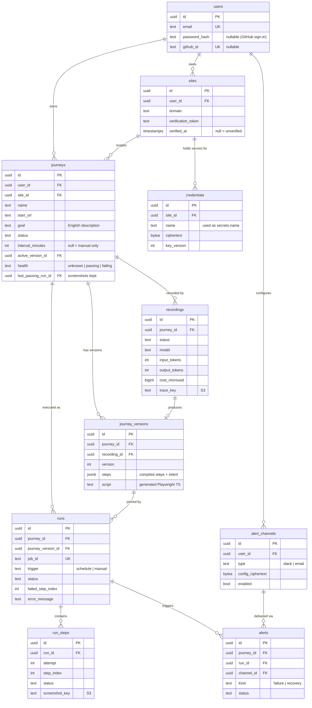

# GhostRider — Data Model

> **Status:** Draft v0.3, **provisional** · Last updated: 2026-11-10
> Related: [Spec](./v1-product-spec.md) · [Architecture](./architecture.md) · [ADRs](./adr/)
>
> The shape of agent traces and compiled steps depends on the M1 agent spike, so those columns are deliberately loose (`jsonb`, or a file in S3) until the trace format settles (ADR-005). Everything else is expected to hold for v1.

## 1. Entity overview



The ERD shows key columns only. Every table also has `created_at`, and mutable tables have `updated_at`. Full definitions are below.

## 2. Conventions

- **Primary keys are UUIDv7.** They're time-sortable, so they index well like a serial ID, but they can't be guessed or counted in URLs (`/journeys/0193…` doesn't reveal that you have 12 journeys).
- **Timestamps** are `timestamptz`, stored in UTC.
- **Enums are `text` with a `CHECK` constraint**, not Postgres `ENUM` types, so adding a value is a one-line migration.
- **Large or binary content goes to S3:** agent traces, screenshots, Playwright trace files. Postgres stores only the object key (`*_key`).
- **Secrets are encrypted in the application** (AES-256-GCM) before they reach Postgres. A `key_version` column lets keys be rotated.
- **Ownership is `user_id` in v1.** When teams arrive, `user_id` on `sites`, `journeys` and `alert_channels` becomes `org_id`. Everything below those tables hangs off them, so the change stays contained.

## 3. Tables

### `users`
| Column | Type | Notes |
|---|---|---|
| `id` | uuid PK | |
| `email` | text, unique | stored lowercased |
| `password_hash` | text, null | argon2id; null for GitHub-only accounts |
| `github_id` | text, unique, null | |
| `created_at` | timestamptz | |

Session tables are whatever the auth library needs (decided in M3) and aren't modeled here.

### `sites`
A domain the user has proven they own. Only verified sites can run on a schedule.

| Column | Type | Notes |
|---|---|---|
| `id` | uuid PK | |
| `user_id` | uuid FK → users | |
| `domain` | text | hostname, e.g. `app.example.com` |
| `verification_method` | text | `dns_txt` \| `meta_tag` |
| `verification_token` | text | random; goes in the TXT record or meta tag |
| `verified_at` | timestamptz, null | null = unverified |
| `created_at` | timestamptz | |

Unique: `(user_id, domain)`.

### `journeys`
A user journey to monitor, plus its schedule and current health.

| Column | Type | Notes |
|---|---|---|
| `id` | uuid PK | |
| `user_id` | uuid FK → users | |
| `site_id` | uuid FK → sites | `start_url` must be on this domain |
| `name` | text | "Signup" |
| `start_url` | text | |
| `goal` | text | the English description the agent works from |
| `status` | text | `draft` \| `recording` \| `ready` \| `active` \| `paused` \| `archived` |
| `interval_minutes` | int, null | 5 / 15 / 60; null = manual only |
| `active_version_id` | uuid FK → journey_versions, null | the version scheduled runs use |
| `health` | text | `unknown` \| `passing` \| `failing`, used for alert dedupe |
| `health_changed_at` | timestamptz, null | |
| `last_run_at` | timestamptz, null | denormalized for the dashboard list |
| `last_passing_run_id` | uuid FK → runs, null | the "known good" run whose screenshots are kept (see §6) |
| `created_at` / `updated_at` | timestamptz | |

`active_version_id` and `journey_versions.journey_id` point at each other. This is resolved by creating the journey first, then setting `active_version_id` once a version exists (the FK is nullable).

### `recordings`
One agent session against a journey. This is the authoring path, and where AI cost is tracked.

| Column | Type | Notes |
|---|---|---|
| `id` | uuid PK | also the BullMQ job ID for the `record` queue |
| `journey_id` | uuid FK → journeys | |
| `status` | text | `queued` \| `running` \| `succeeded` \| `failed` |
| `model` | text | e.g. provider/model name, for the M7 evals |
| `step_count` | int | |
| `input_tokens` / `output_tokens` | int | |
| `cost_microusd` | bigint | cost in millionths of a dollar (integer, so no rounding errors) |
| `trace_key` | text, null | S3 key of the full agent trace (JSON, `trace_format_version` inside) |
| `failure_reason` | text, null | why the agent gave up, shown to the user |
| `started_at` / `finished_at` | timestamptz, null | |
| `created_at` | timestamptz | |

### `journey_versions`
A compiled, **immutable** script. Re-recording creates a new version, and old runs keep pointing at the version they actually ran.

| Column | Type | Notes |
|---|---|---|
| `id` | uuid PK | |
| `journey_id` | uuid FK → journeys | |
| `recording_id` | uuid FK → recordings | |
| `version` | int | 1, 2, 3… per journey |
| `trace_format_version` | int | which trace schema this was compiled from |
| `steps` | jsonb | **provisional.** Per step: action, selector + fallbacks, value or `{{variable}}`, assertion, English intent |
| `script` | text | the generated Playwright TypeScript, for display and debugging |
| `created_at` | timestamptz | |

Unique: `(journey_id, version)`. Rows are never updated.

### `runs`
One execution of a journey version. This is the replay path and the highest-volume table.

| Column | Type | Notes |
|---|---|---|
| `id` | uuid PK | |
| `journey_id` | uuid FK → journeys | |
| `journey_version_id` | uuid FK → journey_versions | |
| `job_id` | text, unique | BullMQ job ID. Makes run creation idempotent (see architecture §3) |
| `trigger` | text | `schedule` \| `manual` |
| `status` | text | `queued` \| `running` \| `passed` \| `failed` \| `errored` |
| `journey_attempts` | int | 1 or 2 (the "retry once" rule) |
| `failed_step_index` | int, null | |
| `error_message` | text, null | |
| `playwright_trace_key` | text, null | S3; **failed runs only** |
| `started_at` / `finished_at` | timestamptz, null | |
| `duration_ms` | int, null | |
| `created_at` | timestamptz | |

Indexes: `(journey_id, created_at DESC)` for run history; `(status, created_at)` for the reconciliation sweep.

`failed` means the **site** failed (alert-worthy). `errored` means **GhostRider** failed (never alerted). The architecture doc explains why that split matters.

### `run_steps`
Per-step results, for the step replay viewer.

| Column | Type | Notes |
|---|---|---|
| `id` | uuid PK | |
| `run_id` | uuid FK → runs, cascade delete | |
| `attempt` | int | 1 or 2 |
| `step_index` | int | matches `journey_versions.steps[i]` |
| `status` | text | `passed` \| `failed` \| `skipped` |
| `error_message` | text, null | |
| `duration_ms` | int | |
| `screenshot_key` | text, null | S3; set only for failed runs and the journey's latest passing run (see §6) |

Unique: `(run_id, attempt, step_index)`. Intent and action aren't copied here; they're read from the pinned `journey_version`, which never changes.

### `credentials`
Test-account secrets, scoped to a site and referenced in journeys as `{{secrets.<name>}}`.

| Column | Type | Notes |
|---|---|---|
| `id` | uuid PK | |
| `site_id` | uuid FK → sites | |
| `name` | text | `email`, `password`, … |
| `ciphertext` | bytea | AES-256-GCM output, including the nonce |
| `key_version` | int | for key rotation |
| `created_at` / `updated_at` | timestamptz | |

Unique: `(site_id, name)`. The plaintext never leaves the worker process, and never reaches the LLM, logs or traces.

### `alert_channels`
| Column | Type | Notes |
|---|---|---|
| `id` | uuid PK | |
| `user_id` | uuid FK → users | |
| `type` | text | `slack` \| `email` |
| `config_ciphertext` | bytea | encrypted, because a Slack webhook URL is a secret |
| `display_name` | text | "#alerts", "me@…" (safe to show) |
| `enabled` | bool | |
| `created_at` | timestamptz | |

In v1, every enabled channel receives alerts for all of a user's journeys. Per-journey routing would add a join table later.

### `alerts`
A log of every alert sent, for the dashboard and for debugging "did I get paged?".

| Column | Type | Notes |
|---|---|---|
| `id` | uuid PK | |
| `journey_id` | uuid FK → journeys | |
| `run_id` | uuid FK → runs | the run that triggered it |
| `channel_id` | uuid FK → alert_channels | |
| `kind` | text | `failure` \| `recovery` |
| `status` | text | `sent` \| `failed` |
| `error_message` | text, null | delivery error |
| `created_at` | timestamptz | |

## 4. Alert deduplication

Alerts fire only when a journey's `health` **changes**, using a race-safe conditional update:

```sql
-- Runner: run confirmed failed
UPDATE journeys SET health = 'failing', health_changed_at = now()
WHERE id = $journey_id AND health <> 'failing'
RETURNING id;   -- a row came back → enqueue a failure alert; no row → already failing, stay quiet
```

The same pattern with `'passing'` triggers a recovery alert. If two runners finish at the same moment, only one gets a row back, so the user is alerted once.

## 5. Database roles (least privilege)

| Role | Used by | Access |
|---|---|---|
| `ghostrider_api` | API | Everything |
| `ghostrider_worker` | Recorder / runner / notifier | Read: `journeys`, `journey_versions`, `credentials`, `alert_channels`, `sites`. Write: `recordings`, `journey_versions` (insert only), `runs`, `run_steps`, `alerts`, `journeys.health`. **No access to `users`** or auth tables |

## 6. Retention

| Data | Kept for |
|---|---|
| `runs` | 90 days |
| `run_steps` rows | 30 days |
| Screenshots of failed runs | 30 days |
| Screenshots of passing runs | only the latest passing run per journey, replaced on the next pass |
| Playwright trace files (failed runs only) | 14 days |
| Agent traces (`recordings.trace_key`) | as long as the journey version that used them exists |

A daily cleanup job (a BullMQ repeatable job) deletes the expired rows and S3 objects together.

**Why screenshots get special treatment.** Rows are cheap; images aren't. At 100 users × 3 journeys every 15 minutes (~10 steps each), screenshotting every step of every run would mean ~288,000 images, about **29 GB per day**, almost all of them showing things working. Instead:

1. The runner captures screenshots in memory as it goes (about 1 MB per run).
2. **Failed run:** upload them, along with the Playwright trace. **During an outage** (the journey is already `failing`), keep screenshots only for the *first* failed run, which shows when it broke, and the *latest* one, which shows what it looks like now. Each new failure deletes the previous "latest" set. The first failed run of the outage is the earliest failed run after `journeys.health_changed_at`, so no extra column is needed. A 6-hour outage stores 2 screenshot sets, not 24.
3. **Passing run:** upload them, swap `journeys.last_passing_run_id` to this run in one atomic update, and delete the previous passing run's screenshots. Each journey keeps exactly one "known good" set.

Screenshot storage now grows only with *failures*, which is the data worth keeping.

**Row growth is bounded too.** At the same scale, `runs` levels off around 2.6M rows (~1 GB) and `run_steps` around 8.6M rows. Retention deletes old rows as new ones arrive, so the tables stop growing, and Postgres handles that comfortably with the indexes above.

## 7. Open questions

- **Trace and step shape:** settled by the M1 spike, then pinned in `packages/shared` and ADR-005.
- **Per-run variables** (value chaining, e.g. `ghost+{{run.id}}@…`): are generated values worth storing on `runs` for debugging? Decide in M2.
- **Partitioning `runs`** by month: not needed at v1 volume. Revisit if run counts grow past roughly 10M rows.
- **Auth library** (and its session tables): decide in M3.
